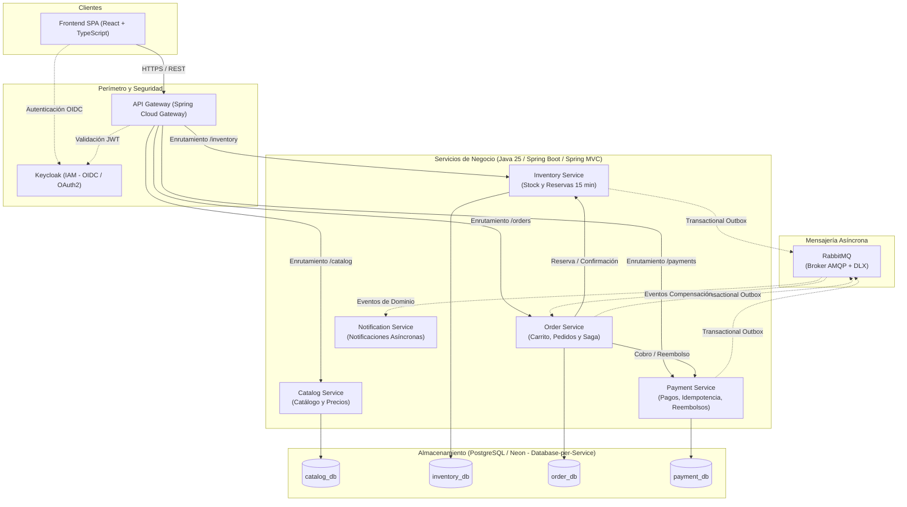
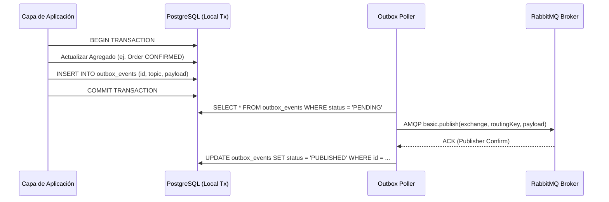

# Arquitectura del Sistema — CommerceHub

Este documento describe la arquitectura global de **CommerceHub**, sus límites de contexto (Bounded Contexts), responsabilidades por componente, patrones de persistencia, integración asíncrona y seguridad.

---

## 1. Visión General del Sistema y Diagrama C4 (Contenedores)

CommerceHub implementa una arquitectura de **microservicios distribuidos** desacoplados, donde cada servicio es autónomo, gestiona su propio almacenamiento de datos y se comunica mediante combinaciones de API REST e intercambio asíncrono de eventos sobre RabbitMQ.

---

## 2. Responsabilidades y Límites de Contexto por Servicio

### 2.1 API Gateway (`api-gateway`) `[DECISIÓN APROBADA]`
- **Tecnología:** Java 25, Spring Boot, Spring Cloud Gateway (modelo reactivo no bloqueante en el perímetro).
- **Límites de Responsabilidad:**
  - Punto de entrada unificado para todas las solicitudes provenientes del frontend SPA.
  - Enrutamiento dinámico hacia los microservicios internos.
  - Terminación de políticas CORS y encabezados de seguridad HTTP.
  - Validación preliminar de tokens JWT emitidos por Keycloak (autenticación) y propagación del contexto de usuario (`userId`, `roles`, `email`) en cabeceras internas hacia los microservicios aguas abajo.
  - **No contiene lógica de negocio ni persistencia propia.**

### 2.2 Catalog Service (`catalog-service`) `[DECISIÓN APROBADA]`
- **Tecnología:** Java 25, Spring Boot, Spring MVC, Spring Data JPA, Flyway, PostgreSQL.
- **Límites de Responsabilidad:**
  - Gestión de categorías, marcas y catálogo de productos (SKU, nombre, descripción, imágenes).
  - Publicación y versionado de precios oficiales de venta en moneda **PEN**.
  - Exposición de endpoints públicos optimizados para consulta y búsqueda.
  - Operaciones de mutación (alta, edición, baja lógica) restringidas exclusivamente a usuarios con rol `ADMIN`.
  - **No gestiona inventario en tiempo real ni transacciones de compra.**

#### Persistencia actualmente implementada — Issue #4

La persistencia pertenece exclusivamente a `catalog-service` y se conecta a `catalog_db`. Spring Data JPA/Hibernate administra las entidades; Flyway aplica las migraciones y Hibernate valida el esquema al iniciar (`ddl-auto=validate`). La migración inicial se encuentra en `services/catalog-service/src/main/resources/db/migration/V1__init_catalog_schema.sql`.

- `Category` se persiste en `categories`, con identificador `BIGINT` generado por identidad, nombre requerido (`VARCHAR(120)`) y descripción opcional (`VARCHAR(500)`). No hay unicidad definida para nombres de categoría.
- `Product` se persiste en `products`, con identificador `BIGINT` generado por identidad, SKU requerido (`VARCHAR(64)`), nombre requerido (`VARCHAR(200)`), descripción opcional (`VARCHAR(2000)`), categoría, precio, moneda, URL de imagen opcional (`VARCHAR(2048)`) y estado `published` (por defecto `false` en la base de datos).
- `@Getter` de Lombok genera únicamente los getters de estas entidades. Los constructores que validan el dominio y los métodos de cambio de precio/publicación siguen explícitos; no se generan setters, `equals`, `hashCode` ni `toString` para las entidades.
- `Currency` es un enum persistido como texto en `VARCHAR(3)`. Actualmente solo admite `PEN`, conforme a la moneda base aprobada; la base de datos también usa PEN como valor predeterminado y lo restringe con un check.
- Los precios usan `BigDecimal` y `NUMERIC(19,2)`: se eligieron 17 dígitos enteros más dos decimales para representar importes PEN exactos dentro de un rango amplio. El dominio rechaza importes nulos, no positivos, con más de dos decimales efectivos o fuera de ese rango; la base de datos también impone `price > 0`.
- El dominio exige texto no vacío para el SKU y el nombre del producto y el nombre de categoría. La base de datos refuerza esos campos con `NOT NULL` y checks que rechazan cadenas en blanco.
- `uk_products_sku` garantiza unicidad del SKU. No se aplica normalización en la aplicación. La restricción de PostgreSQL compara los valores respetando mayúsculas/minúsculas; esa es la semántica técnica actual, no una política comercial confirmada.
- `fk_products_categories` exige que la categoría exista y restringe su eliminación mientras tenga productos asociados. Los índices `idx_products_category_id` e `idx_products_published` cubren filtros por categoría y publicación.
- La conexión requiere `CATALOG_DB_URL`, `CATALOG_DB_USERNAME` y `CATALOG_DB_PASSWORD`. No se definen credenciales en el código. Flyway es la fuente de cambios del esquema; Hibernate no crea ni actualiza tablas.

#### Consulta pública y alcance pendiente

Issue #5 implementa la consulta pública con `GET /api/v1/products`, `GET /api/v1/products/{id}` y `GET /api/v1/categories`. Las búsquedas y el detalle solo incluyen productos publicados; el listado filtra por categoría y coincidencia parcial en nombre, pagina en PostgreSQL y ordena por nombre e ID ascendente. Las categorías públicas son las que tienen al menos un producto publicado. Los DTO HTTP mantienen los IDs numéricos `BIGINT` del esquema y las respuestas de error usan Problem Details. La gestión administrativa, autorización de mutaciones, inventario, marcas e historial de precios no forman parte de esta API. La sensibilidad del SKU a mayúsculas/minúsculas sigue pendiente de decisión de negocio; cualquier cambio de normalización requiere resolver esa política primero.

### 2.3 Inventory Service (`inventory-service`) `[DECISIÓN APROBADA]`
- **Tecnología:** Java 25, Spring Boot, Spring MVC, Spring Data JPA, Flyway, PostgreSQL.
- **Límites de Responsabilidad:**
  - Control de existencias físicas (`total_stock`) y existencias disponibles para venta (`available_stock`).
  - Gestión del ciclo de vida de **Reservas Temporales de Stock** con tiempo de expiración estricto de **15 minutos**.
  - Consolidación definitiva de deducción de stock ante confirmación de compra.
  - Liberación de reservas por cancelación o expiración de tiempo.
  - Registro de auditoría de movimientos de stock (Kardex: entradas, reservas, deducciones, reingresos).
  - **No procesa pagos ni conoce detalles de clientes o métodos de cobro.**

### 2.4 Order Service (`order-service`) `[DECISIÓN APROBADA]`
- **Tecnología:** Java 25, Spring Boot, Spring MVC, Spring Data JPA, Flyway, PostgreSQL.
- **Límites de Responsabilidad:**
  - Persistencia y gestión del Carrito de Compras de los clientes autenticados.
  - Creación y mantenimiento del ciclo de vida del Pedido (`Order`: `DRAFT`, `CHECKOUT_PENDING`, `CONFIRMED`, `IN_PREPARATION`, `SHIPPED`, `DELIVERED`, `CANCELLED`).
  - **Coordinación y Orquestación Persistente de la Saga de Checkout.**
  - Ejecución de la política de cancelación directa del cliente (exclusivamente permitida antes de `IN_PREPARATION`).
  - Cálculo de totales de compra incorporando la tarifa plana de envío de **S/ 10.00**.
  - Publicación de eventos de dominio a través del patrón **Transactional Outbox**.

### 2.5 Payment Service (`payment-service`) `[DECISIÓN APROBADA]`
- **Tecnología:** Java 25, Spring Boot, Spring MVC, Spring Data JPA, Flyway, PostgreSQL.
- **Límites de Responsabilidad:**
  - Procesamiento de cobros simulados mediante la interfaz `PaymentProviderGateway`.
  - Garantía de **idempotencia estricta** en cobros vía `Idempotency-Key` / tabla de control transaccional.
  - Manejo de estados de transacción: `INITIATED`, `PROCESSING`, `SUCCESS`, `DECLINED`, `UNCERTAIN`.
  - **Mecanismo de Conciliación Obligatoria** ante fallos de timeout o respuestas ambiguas.
  - Gestión del ciclo de vida de Reembolsos (`Refund`), requiriendo confirmación formal (`REFUND_CONFIRMED`) antes de marcarlos completados.
  - Reportabilidad financiera independiente: ventas brutas confirmadas separadas de débitos por reembolso.
  - **Cumplimiento de Seguridad (PCI-DSS Lite):** Prohibición estricta de persistir número de tarjeta completo (PAN) y CVV. Solo almacena token, marca y últimos 4 dígitos.

### 2.6 Notification Service (`notification-service`) `[DECISIÓN APROBADA]`
- **Tecnología:** Java 25, Spring Boot, Spring AMQP (RabbitMQ listener).
- **Límites de Responsabilidad:**
  - Consumidor puro y asíncrono de eventos de dominio publicados en RabbitMQ.
  - Envío simulado de correos transaccionales (confirmación de compra, cambios de estado logístico, notificación de reembolso).
  - Implementación desacoplada y tolerante a fallos: caídas en el servicio de notificaciones no detienen la operación de la tienda ni la Saga.
  - Registro estructurado de notificaciones emitidas para auditoría.

---

## 3. Patrones de Arquitectura Distribuida Adoptados

### 3.1 Autonomía de Datos (Database-per-Service) `[DECISIÓN APROBADA]`
- Cada microservicio opera con su propia base de datos o esquema lógicamente aislado en PostgreSQL / Neon.
- Se elimina cualquier dependencia de acoplamiento a nivel de base de datos (cero *cross-database foreign keys*, cero vistas compartidas, cero *distributed transactions* 2PC/XA).
- Si un servicio requiere información de otro, la solicita vía API interna o la mantiene sincronizada mediante eventos de dominio.

### 3.2 Transactional Outbox Pattern `[DECISIÓN APROBADA]`
Para evitar el problema de la doble escritura (*dual-write problem*) donde la base de datos se actualiza pero el mensaje en RabbitMQ se pierde por caída de red, se adopta el patrón Transactional Outbox:
1. Dentro de la transacción local de base de datos del microservicio, el agregado muta y se inserta un registro en la tabla `outbox_events`.
2. Ambas operaciones ocurren de forma atómica en PostgreSQL.
3. Un proceso secundario asíncrono (relayer/poller o Change Data Capture) lee los eventos pendientes de la tabla outbox y los publica en el Exchange correspondiente de RabbitMQ.
4. Tras confirmación del broker (RabbitMQ Publisher Confirms), el evento en outbox se marca como publicado o se elimina.

### 3.3 Consumidores Idempotentes (Idempotent Consumer Pattern) `[DECISIÓN APROBADA]`
- Todo consumidor en RabbitMQ implementa verificación previa de deduplicación.
- Se mantiene una tabla `processed_messages (message_id, consumer_name, processed_at)` en la base de datos del servicio receptor.
- Si un mensaje con el mismo ID arriba por reintento de RabbitMQ, el consumidor detecta su registro previo y descarta el procesamiento evitando efectos duplicados (*at-least-once to effectively-once processing*).

### 3.4 Manejo de Errores y Dead Lettering `[DECISIÓN APROBADA]`
- Errores transitorios (ej. timeout de red temporal) se reintentan con *Exponential Backoff*.
- Errores no recuperables (ej. payload corrupto, violación de regla de negocio no contemplada) se enrutan a un **Dead Letter Exchange (DLX)** y su correspondiente cola de mensajes muertos (**DLQ**) para inspección y reprocesamiento manual.

---

## 4. Seguridad, Autenticación y Autorización (Keycloak + OIDC) `[DECISIÓN APROBADA]`

- **Proveedor de Identidad:** Keycloak centraliza la gestión de usuarios, credenciales y asignación de roles.
- **Protocolo:** OpenID Connect (OIDC) / OAuth 2.0 con flujo Authorization Code con PKCE para el frontend SPA.
- **Token JWT:** El cliente envía el Bearer Token al API Gateway en cada solicitud HTTP.
- **Control de Acceso Basado en Roles (RBAC):**
  - Rol `CUSTOMER`: Otorgado automáticamente por el registro público. Puede gestionar su propio carrito, órdenes y cancelaciones tempranas.
  - Rol `ADMIN`: Asignado exclusivamente mediante provisión administrativa en Keycloak. Puede alterar el catálogo, modificar existencias de inventario y actualizar estados de pedidos.
- **Protección de Datos Financieros:** En ningún punto del ciclo de vida se recolectan o transmiten credenciales de pago completas sin tokenizar, eliminando el riesgo de fuga de datos de tarjetas.
