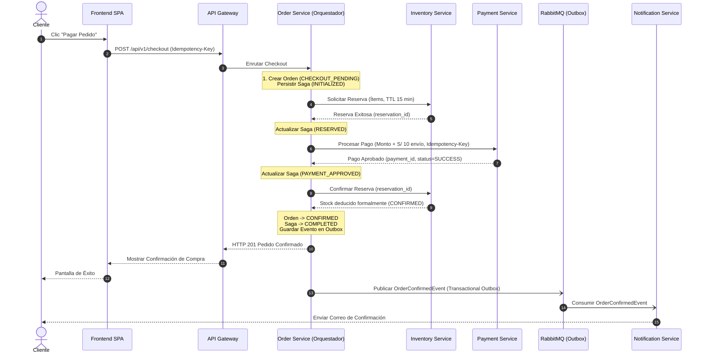
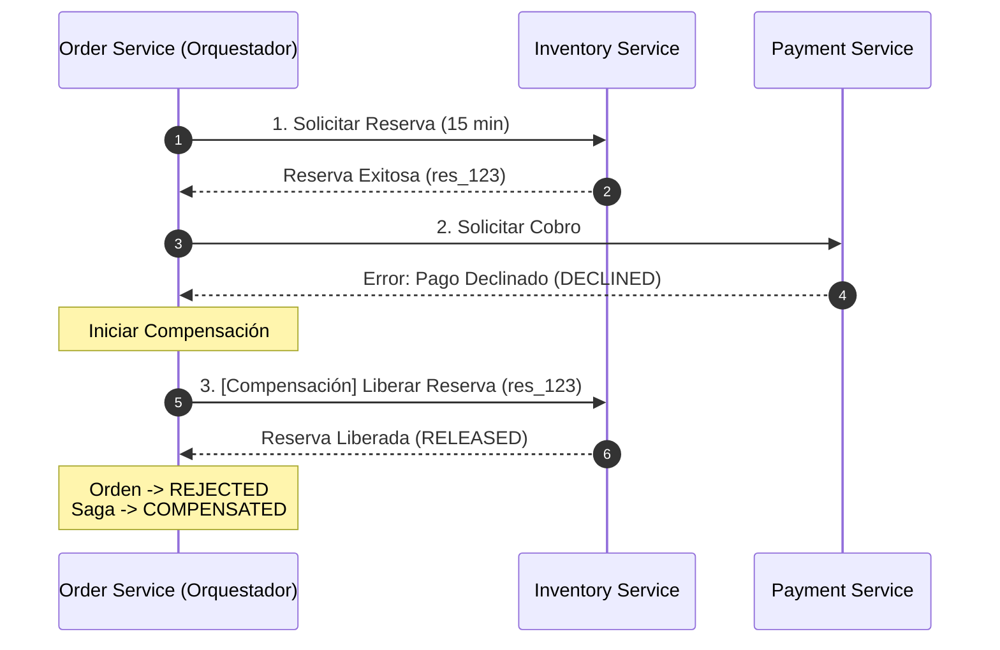
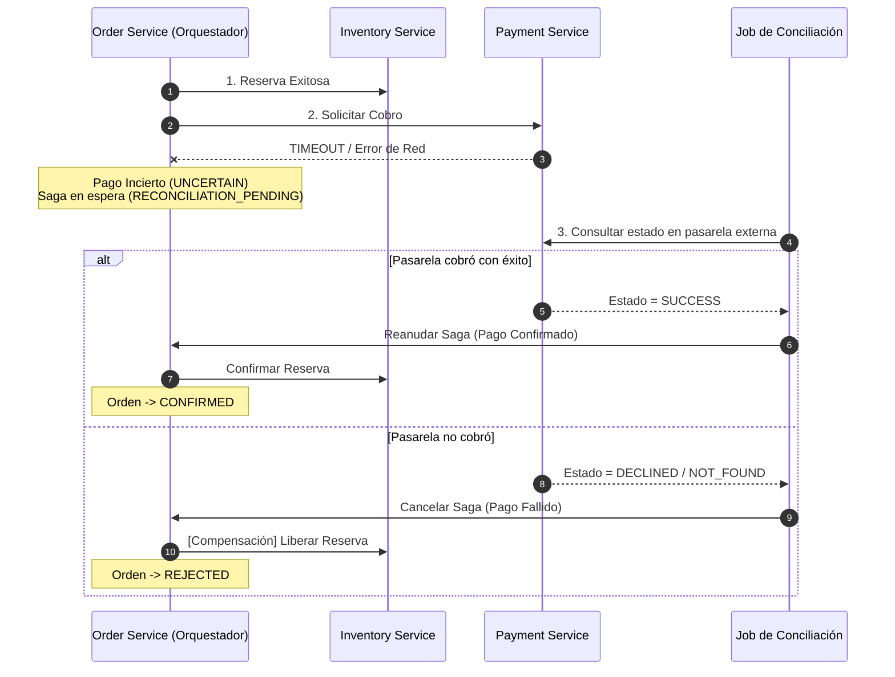

# Especificación de la Saga de Checkout — CommerceHub

Este documento detalla el diseño, la persistencia, los flujos normales, los escenarios de falla, las compensaciones y los mecanismos de recuperación de la **Saga de Checkout** en CommerceHub.

---

## 1. Modelo de Coordinación: Orquestación Persistente `[DECISIÓN APROBADA]`

La Saga de Checkout sigue un modelo de **Orquestación Centralizada**, donde el microservicio **`order-service`** actúa como el coordinador (*Saga Orchestrator*).

### Justificación de la Elección
1. **Visibilidad y Trazabilidad:** Almacenar el estado de la saga en una tabla centralizada permite saber en qué paso exacto se encuentra una compra y facilita la auditoría operativa.
2. **Control Estricto de Compensaciones:** Permite desencadenar acciones compensatorias secuenciales de forma determinista y predecible.
3. **Evita Dependencias Cíclicas:** Previene que `payment-service` o `inventory-service` conozcan el flujo general del negocio o se acoplen entre sí.

---

## 2. Persistencia y Recuperación de la Instancia de Saga `[DECISIÓN APROBADA]`

Para evitar inconsistencias ante caídas de nodos, la Saga persiste su estado en la tabla `saga_instances` de `order-service` dentro de cada paso transaccional:

### Estructura de Persistencia de la Saga (`saga_instances`) `[PROPUESTA PENDIENTE]`
- `saga_id` (UUID - Clave Primaria)
- `order_id` (UUID - Clave Foránea a la Orden)
- `idempotency_key` (String - Clave provista por el cliente)
- `current_step` (Enum: `INITIALIZED`, `RESERVATION_PENDING`, `RESERVED`, `PAYMENT_PENDING`, `COMPLETED`, `COMPENSATION_PENDING`, `COMPENSATED`, `FAILED`)
- `payload` (JSONB - Copia de los ítems, montos, identificador de reserva y token de pago)
- `created_at` / `updated_at` (Timestamp)

### Mecanismo de Recuperación ante Caídas (Saga Recovery Worker)
- Un proceso programado en `order-service` escanea periódicamente instancias de saga que permanezcan en estados transitorios (`RESERVATION_PENDING`, `PAYMENT_PENDING`, `COMPENSATION_PENDING`) más allá de un umbral de timeout configurado (ej. 60 segundos).
- El recuperador reintenta la consulta de estado o desencadena la compensación correspondiente, garantizando que ninguna orden quede "huérfana".

---

## 3. Flujo Exitoso (Happy Path) `[DECISIÓN APROBADA]`

### Pasos Detallados del Happy Path:
1. **Inicio:** El cliente somete el checkout. `order-service` crea la orden en estado `CHECKOUT_PENDING` y abre la instancia de Saga.
2. **Paso 1 (Reserva):** `order-service` solicita la reserva temporal de los ítems con TTL de 15 minutos en `inventory-service`. `inventory-service` valida disponibilidad y bloquea el stock.
3. **Paso 2 (Pago):** Con la reserva asegurada, `order-service` solicita a `payment-service` el cobro total (subtotal de productos + S/ 10.00 de envío plano) con la clave de idempotencia. `payment-service` interactúa con el simulador y confirma la captura del cobro.
4. **Paso 3 (Consolidación de Inventario):** `order-service` notifica a `inventory-service` que confirme la reserva. El stock reservado se transforma en deducción definitiva de existencias.
5. **Cierre:** `order-service` cambia el estado de la orden a `CONFIRMED`, vacía el carrito del cliente, registra el evento `OrderConfirmedEvent` en su tabla outbox para notificación asíncrona, y responde de forma síncrona al cliente.

---

## 4. Escenarios de Falla y Acciones Compensatorias `[DECISIÓN APROBADA]`

### Escenario A: Stock Insuficiente en la Reserva
- **Falla:** `inventory-service` responde que uno o varios ítems no cuentan con existencias disponibles.
- **Acción Compensatoria:**
  - No se ha cobrado dinero ni creado reserva alguna.
  - La orden en `order-service` pasa a estado `REJECTED`.
  - La instancia de Saga finaliza en estado `FAILED`.
  - Se retorna HTTP 409 / 422 al cliente informando los productos agotados.

### Escenario B: Pago Rechazado (Fondos Insuficientes / Tarjeta Denegada)
- **Falla:** La reserva en `inventory-service` fue exitosa, pero `payment-service` retorna `DECLINED`.
- **Acción Compensatoria:**
  1. `order-service` ejecuta el paso compensatorio: invoca a `inventory-service` para liberar la reserva (`Release Reservation`).
  2. `inventory-service` cambia el estado de la reserva a `RELEASED` y suma las unidades de vuelta al stock disponible.
  3. La orden pasa a `REJECTED`.
  4. La Saga finaliza en `COMPENSATED`.
  5. Se informa al cliente el motivo del rechazo del pago para que intente con otro método.

### Escenario C: Expiración de la Ventana de 15 Minutos
- **Falla:** El cliente abandonó la pantalla de pago o tardó más de 15 minutos en completar el formulario de pago.
- **Detección:** La reserva en `inventory-service` expira automáticamente por temporizador (`EXPIRED`).
- **Acción Compensatoria:**
  - Si una petición de pago arriba posterior al minuto 15, `order-service` valida la vigencia de la reserva antes de cobrar; al detectar que expiró, rechaza la operación sin procesar el cobro.
  - La orden se cancela por expiración (`REJECTED` / `CANCELLED`).

### Escenario D: Incertidumbre en el Pago (Timeout / Network Failure) `[DECISIÓN APROBADA]`
- **Falla:** Al invocar el cobro a `payment-service`, se produce un timeout de red o error HTTP 504. Se desconoce si el cargo fue procesado o no.
- **Acción Obligatoria de la Saga:**
  1. **Prohibición:** Queda prohibido liberar la reserva de inventario de inmediato o asumir el pago como cancelado (riesgo de doble cobro sin producto).
  2. La transacción se marca en `payment-service` como `UNCERTAIN` / `PENDING_RECONCILIATION`.
  3. La Saga en `order-service` retiene la reserva y agenda una tarea de reconciliación.
  4. El reconciliador consulta a la pasarela utilizando la referencia de la transacción.
     - Si la pasarela **confirma el cobro**: La Saga retoma el Happy Path (confirma reserva y pasa orden a `CONFIRMED`).
     - Si la pasarela **confirma que no hubo cobro**: La Saga ejecuta la compensación (libera reserva y marca orden `REJECTED`).

### Escenario E: Falla en Confirmación de Stock tras Pago Exitoso
- **Falla:** El pago fue debitado con éxito en `payment-service`, pero la llamada a `inventory-service` para consolidar la reserva falla por caída de red persistente o corrupción.
- **Mecanismo de Recuperación:**
  1. La Saga intenta reintentos controlados con *backoff* hacia `inventory-service` (operación idempotente).
  2. Si tras los reintentos la falla es definitiva (ej. reserva expiró inesperadamente por retraso de red):
     - La Saga activa la **Compensación Crítica**: solicita un reembolso obligatorio e inmediato a `payment-service` (`POST /refund`).
     - El pedido se cancela con estado `CANCELLED` y se registra una alerta de inconsistencia para auditoría administrativa.

---

## 5. Matriz de Idempotencia en la Saga

| Operación | Clave de Idempotencia | Comportamiento ante Duplicados |
| :--- | :--- | :--- |
| **Crear Reserva** | `order_id` | Si ya existe una reserva activa para la misma orden, retorna el `reservation_id` previo sin duplicar reservas de stock. |
| **Cobrar Pago** | `idempotency_key` (UUID) | Si la clave ya fue procesada, retorna la respuesta previa (`SUCCESS`, `DECLINED`) sin generar un nuevo cargo en el simulador. |
| **Confirmar Reserva** | `reservation_id` | Si ya está en estado `CONFIRMED`, retorna HTTP 200/OK sin descontar stock adicional. |
| **Liberar Reserva** | `reservation_id` | Si ya está en estado `RELEASED`, retorna HTTP 200/OK sin devolver stock doble. |
| **Solicitar Reembolso**| `payment_id` + `refund_key` | Si el reembolso ya fue solicitado o confirmado, retorna el registro existente sin duplicar el abono. |
