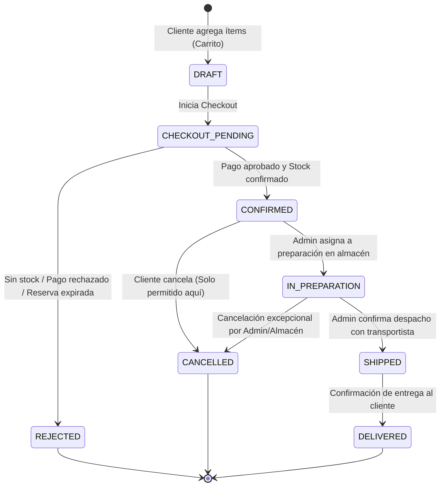
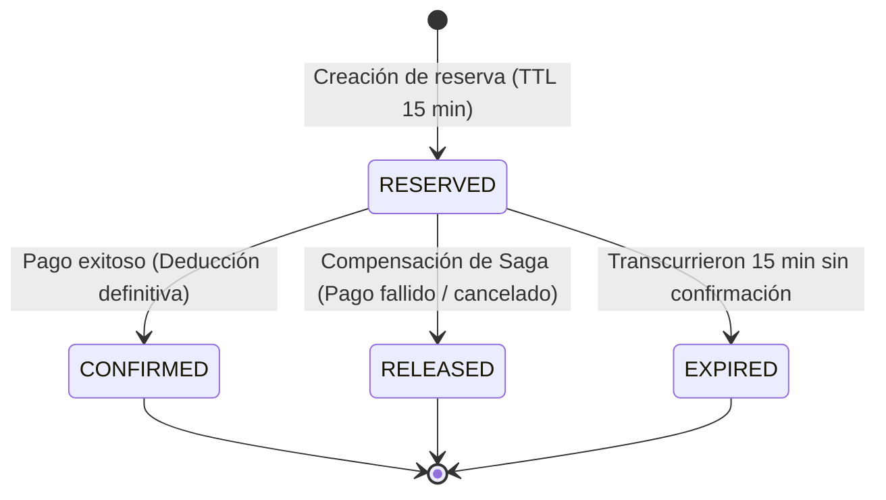
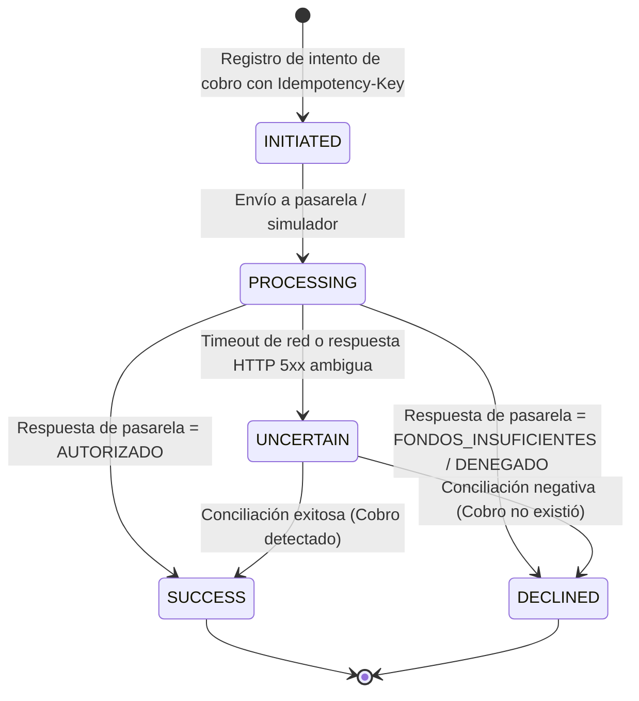
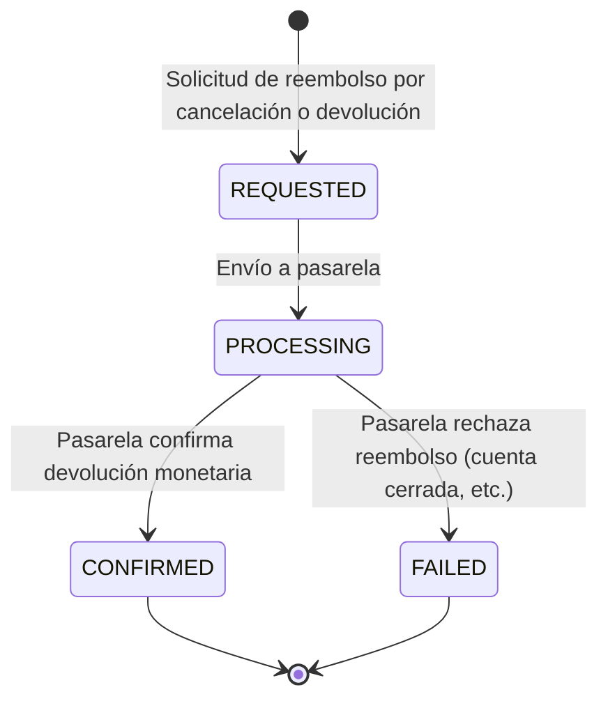

# Máquinas de Estado y Transiciones — CommerceHub

Este documento especifica formalmente los ciclos de vida y las máquinas de estados para los cuatro agregados centrales de CommerceHub: **Pedido**, **Pago**, **Reserva de Inventario** y **Reembolso**. 

Cada ciclo de vida es autónomo y encapsulado en su respectivo microservicio, manteniéndose sincronizado a través de la Saga orquestada y eventos de dominio.

---

## 1. Ciclo de Vida del Pedido (`Order`) — `order-service`

El agregado `Order` modela la intención de compra del cliente y su evolución logística.

### Diagrama de Estados del Pedido

### Tabla de Transiciones del Pedido

| Estado Origen | Evento / Acción Detonante | Condición / Guardia | Estado Destino | Rol Ejecutor | Clasificación |
| :--- | :--- | :--- | :--- | :--- | :--- |
| `DRAFT` | Iniciar Checkout | Carrito con al menos 1 ítem con datos válidos | `CHECKOUT_PENDING` | Cliente | `[PROPUESTA PENDIENTE]` |
| `CHECKOUT_PENDING` | Confirmación de Saga | Reserva confirmada y pago aprobado (`PAID`) | `CONFIRMED` | Sistema (Saga) | `[DECISIÓN APROBADA]` |
| `CHECKOUT_PENDING` | Falla en Checkout | Stock insuficiente, pago declinado o timeout | `REJECTED` | Sistema (Saga) | `[DECISIÓN APROBADA]` |
| `CONFIRMED` | Cancelación de Cliente | Pedido aún NO está en preparación | `CANCELLED` | Cliente | `[DECISIÓN APROBADA]` |
| `CONFIRMED` | Iniciar Preparación | Personal de almacén inicia empaque físico | `IN_PREPARATION` | Administrador | `[DECISIÓN APROBADA]` |
| `IN_PREPARATION` | Intentar Cancelación Cliente | El pedido ya está en preparación | *Rechazado (HTTP 409)* | Cliente | `[DECISIÓN APROBADA]` |
| `IN_PREPARATION` | Cancelación Administrativa | Incidencia grave en almacén / falta física | `CANCELLED` | Administrador | `[PROPUESTA PENDIENTE]` |
| `IN_PREPARATION` | Despacho a Transportista | Guía de despacho generada y entregada | `SHIPPED` | Administrador | `[DECISIÓN APROBADA]` |
| `SHIPPED` | Entrega Completada | Notificación de transportista o cliente | `DELIVERED` | Administrador / Sistema | `[DECISIÓN APROBADA]` |

> [!IMPORTANT]
> **Regla de oro de cancelación del cliente:** La transición de `CONFIRMED` a `CANCELLED` es la **única** que un cliente puede invocar directamente. Una vez alcanzado el estado `IN_PREPARATION`, el cliente tiene bloqueada la cancelación.

---

## 2. Ciclo de Vida de la Reserva de Inventario (`Reservation`) — `inventory-service`

El agregado `InventoryReservation` bloquea existencias físicas temporalmente para garantizar disponibilidad durante el checkout.

### Diagrama de Estados de la Reserva

### Tabla de Transiciones de la Reserva

| Estado Origen | Detonante | Condición | Estado Destino | Clasificación |
| :--- | :--- | :--- | :--- | :--- |
| `[*] (Ninguno)` | Solicitud de Reserva | Stock disponible $\ge$ unidades solicitadas | `RESERVED` | `[DECISIÓN APROBADA]` |
| `RESERVED` | Confirmar Reserva | Pago completado dentro de los 15 minutos | `CONFIRMED` | `[DECISIÓN APROBADA]` |
| `RESERVED` | Liberar Reserva | Pago declinado o cancelación en checkout | `RELEASED` | `[DECISIÓN APROBADA]` |
| `RESERVED` | Expiración de Tiempo | `now() > reservation_time + 15 min` | `EXPIRED` | `[DECISIÓN APROBADA]` |

- **Efecto de `CONFIRMED`:** El stock reservado se descuenta formalmente del inventario físico total (`stock_total = stock_total - cantidad`).
- **Efecto de `RELEASED` o `EXPIRED`:** Las unidades reservadas vuelven a sumarse al stock disponible para venta general (`stock_disponible = stock_disponible + cantidad`).

---

## 3. Ciclo de Vida del Pago (`PaymentTransaction`) — `payment-service`

Modela la interacción con la pasarela de pagos (simulador).

### Diagrama de Estados del Pago

### Tabla de Transiciones del Pago

| Estado Origen | Detonante | Condición | Estado Destino | Clasificación |
| :--- | :--- | :--- | :--- | :--- |
| `[*] (Ninguno)` | Crear Intento de Pago | Clave de idempotencia única | `INITIATED` | `[DECISIÓN APROBADA]` |
| `INITIATED` | Iniciar Procesamiento | Conexión con simulador abierta | `PROCESSING` | `[PROPUESTA PENDIENTE]` |
| `PROCESSING` | Aprobación de Pasarela | Fondos válidos y confirmación de cobro | `SUCCESS` | `[DECISIÓN APROBADA]` |
| `PROCESSING` | Rechazo de Pasarela | Fondos insuficientes, tarjeta inválida | `DECLINED` | `[DECISIÓN APROBADA]` |
| `PROCESSING` | Timeout de Red / Desconexión | Sin respuesta o error indeterminado | `UNCERTAIN` | `[DECISIÓN APROBADA]` |
| `UNCERTAIN` | Conciliación Externa | Verificación confirma cargo en pasarela | `SUCCESS` | `[DECISIÓN APROBADA]` |
| `UNCERTAIN` | Conciliación Externa | Verificación confirma ausencia de cargo | `DECLINED` | `[DECISIÓN APROBADA]` |

---

## 4. Ciclo de Vida del Reembolso (`Refund`) — `payment-service`

El reembolso es un agregado separado e inmutable, emitido sobre una transacción de pago previa en estado `SUCCESS`.

### Diagrama de Estados del Reembolso

### Tabla de Transiciones del Reembolso

| Estado Origen | Detonante | Condición | Estado Destino | Clasificación |
| :--- | :--- | :--- | :--- | :--- |
| `[*] (Ninguno)` | Solicitud de Devolución | Pago original en `SUCCESS` y monto válido | `REQUESTED` | `[DECISIÓN APROBADA]` |
| `REQUESTED` | Envío a Pasarela | Conexión con pasarela disponible | `PROCESSING` | `[PROPUESTA PENDIENTE]` |
| `PROCESSING` | Respuesta Pasarela = Éxito | Proveedor devuelve confirmación de abono | `CONFIRMED` | `[DECISIÓN APROBADA]` |
| `PROCESSING` | Respuesta Pasarela = Falla | Proveedor rechaza la operación | `FAILED` | `[DECISIÓN APROBADA]` |

> [!IMPORTANT]
> **Requisito Aprobado:** El sistema nunca marcará el reembolso como completado hasta que alcance el estado `CONFIRMED` con acuse formal de la pasarela.

---

## 5. Matriz de Coherencia Cruzada de Estados

Para que el sistema sea consistente durante la ejecución distribuida, los estados de los diferentes servicios deben correlacionarse de la siguiente manera:

| Escenario de Negocio | Estado de Order | Estado de Reservation | Estado de Payment | Estado de Refund |
| :--- | :--- | :--- | :--- | :--- |
| **Inicio de Checkout** | `CHECKOUT_PENDING` | `RESERVED` | `INITIATED` | N/A |
| **Compra Exitosa** | `CONFIRMED` | `CONFIRMED` | `SUCCESS` | N/A |
| **Rechazo por Falta de Stock** | `REJECTED` | *(No se crea)* | *(No se inicia)* | N/A |
| **Rechazo por Pago Declinado** | `REJECTED` | `RELEASED` | `DECLINED` | N/A |
| **Timeout de Pago en Checkout** | `CHECKOUT_PENDING` | `RESERVED` | `UNCERTAIN` | N/A |
| **Cancelación Directa de Cliente** | `CANCELLED` | `CONFIRMED` $\to$ Reingreso stock | `SUCCESS` | `REQUESTED` $\to$ `CONFIRMED` |
| **Expiración de Tiempo (15 min)** | `REJECTED` | `EXPIRED` | `DECLINED` / N/A | N/A |
